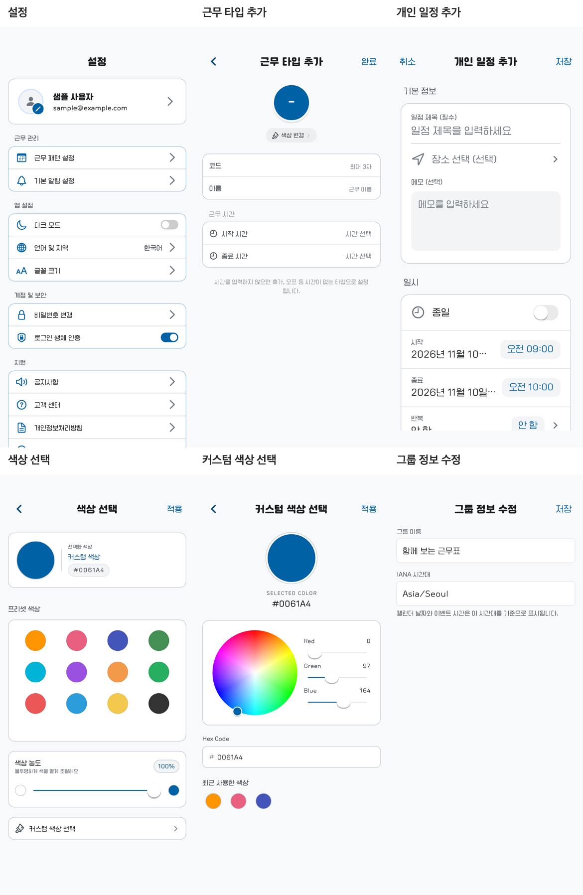

# ShiftMate 전체 디자인 검토 — 2026-11-10

> 이 보고서는 수정 전 검토 기록이다. 사용자 승인 후 반영한 결과는 [수정 방향서의 구현 결과](UI_DESIGN_DIRECTION_2026-11-10.md#구현-결과)와 ADR-0038을 참조한다. 아래 캡처와 측정값은 수정 전 상태를 보존한다.

## 목적과 결론

사용자 요청에 따라 **앱 내부 일관성**과 **일반적인 모바일 UI 관례**를 같은 비중으로 검토했다. 현재 코드는 밝은 회색 배경, 파란색 강조, 흰색 둥근 카드와 Cupertino 내비게이션을 공유한다. 차이가 두드러지는 영역은 설정·근무 타입/색상 입력 화면의 축소된 본문, 상대적으로 큰 개인 일정 입력 화면, 기본 입력 상자만 사용하는 그룹 정보 수정 화면이다.

우선 처리할 사용성 문제는 작은 화면의 커스텀 색상 스크롤 차단과 설정의 실제 동작 없는 스위치 표시다. 아래 개선 방향은 검토 제안이며 채택된 설계 결정은 아니다.

## 확인 방법과 한계

- 기준: `PROJECT_CONTEXT.md`의 UI 디자인 시스템, ADR-0003/0004/0005/0016/0028 및 ADR-0029 상태 갱신, 실제 `AppTheme`·`main.dart`·화면 진입 코드.
- 정적 범위: `presentation/pages/`의 17개 페이지 파일과 색상 선택 페이지 2개, 앱 진입/업데이트 게이트 및 관련 폼·공용 컴포넌트. `schema.drawio`·`visibility_flow.drawio`는 앞선 작업에서 읽은 내용을 유지했으며 DB/공개 정책을 새로 판정하거나 변경하지 않았다.
- 시각 확인: 실제 Flutter 위젯을 가짜 계정/친구 데이터로 렌더링했다. 11개 화면, 공용 버튼 바/알림 카드 2개, 커스텀 색상 크기·글자 배율 추가 사례 2개로 총 15개 PNG와 측정 JSON을 생성했다.
- 기본 조건: 390×844 logical pixels, 글자 배율 1, 앱의 Cafe24 본문/제목 폰트 및 Cupertino 아이콘 폰트를 로드했다. 작은 화면은 320×568, 글자 확대 사례는 390×844에서 배율 2다. PNG는 2배 해상도이며 제시하는 치수는 PNG 픽셀이 아닌 Flutter logical pixels다.
- 화면을 독립 route의 home으로 렌더링해 일부 자동 뒤로가기 버튼은 캡처에 나타나지 않는다. 이것을 앱의 뒤로가기 결함으로 판정하지 않았다. OS 상태바·실제 키보드·실기기 VoiceOver·전환 애니메이션·전체 로그인 후 실서버 탐색은 이번 시각 검증 범위에 포함하지 않았다.
- 저장소의 App Store 합성 이미지도 보조 비교했지만, 현재 위젯 렌더링의 대체 근거로 사용하지 않았다.
- `ui-ux-pro-max`의 모바일 터치 기준 및 내비게이션 검색·앱 점검표를 참고했다. 검색 결과 중 웹 전용 내용은 모바일 판단에 적용하지 않았다.

## 화면 비교

위: 설정 / 근무 타입 추가 / 개인 일정 추가. 아래: 색상 선택 / 커스텀 색상 선택 / 그룹 정보 수정. 모두 같은 390×844 크기와 동일한 테마·글자 배율이다.

## 주요 발견

### F01 · 높음 · 커스텀 색상: 작은 화면에서 하단 기능에 접근 불가

- 확인된 사실: 본문 `ListView`에 `NeverScrollableScrollPhysics`가 설정돼 있다. 320×568에서 스크롤 가능한 콘텐츠 초과분은 **147.4**이며, 위로 500 드래그한 뒤에도 스크롤 위치는 **0 → 0**이었다. `최근 사용한 색상`은 해당 뷰포트/캐시 범위에서 생성되지 않았고 캡처에도 나타나지 않는다.
- 영향: 작은 휴대폰에서 화면 아래 색상 기록에 접근할 수 없다. 일반적인 폼의 스크롤 기대와 다르다.
- 근거: [스크롤 설정](../lib/features/calendar/presentation/widgets/shift_custom_color_picker_page.dart#L285), [측정 JSON](../artifacts/design_audit_2026-11-10/measurements.json), [작은 화면 캡처](../artifacts/design_audit_2026-11-10/custom_color_small.png).
- 문서 대조: PROJECT_CONTEXT에도 세로 스크롤 차단이 명시되어 있다. 구현 누락으로 추정하지 않으며, 기존 의도에 작은 화면에서의 접근성 비용이 발생한 것으로 본다. 390×844·글자 배율 2에서는 현재 내용이 들어가므로 모든 확대 조건에서 실패한다고 확대 해석하지 않는다.
- 개선 방향: 기본 세로 스크롤을 허용하거나 화면이 충분히 클 때만 고정한다. HEX 키보드가 열린 상태도 후속 검증한다.

### F02 · 높음 · 설정: 활성 상태처럼 보이는 미구현 기능

- 확인된 사실: `로그인 생체 인증`은 `value: true`로 고정된 커스텀 그림이며 실제 `CupertinoSwitch`가 아니다. `다크 모드`도 고정 상태다. 해당 행을 누르면 상태 변경 대신 `준비 중인 기능` 다이얼로그가 열린다. 기본 알림·언어·글꼴·비밀번호·공지·고객 센터도 일반 활성 행처럼 표시되고 같은 안내로 연결된다.
- 영향: 특히 생체 인증이 이미 켜진 것으로 이해될 수 있다. 익숙한 스위치의 시각 표현과 실제 기능 상태가 맞지 않는다.
- 근거: [고정된 생체 인증 값](../lib/features/auth/presentation/pages/settings_page.dart#L310), [행 동작](../lib/features/auth/presentation/pages/settings_page.dart#L589), [커스텀 스위치](../lib/features/auth/presentation/pages/settings_page.dart#L620), [설정 캡처](../artifacts/design_audit_2026-11-10/settings.png). 렌더링에서도 실제 `CupertinoSwitch` 개수 0을 확인했다.
- 개선 방향: 미구현 항목에 `준비 중`을 먼저 표시하고, 기능이 켜진 것처럼 보이는 스위치는 제공 시점에 실제 저장 상태와 연결한다. 현재 의도는 문서에 명시되어 있어 우발적 구현 오류로 분류하지 않는다.

### F03 · 중간 · 설정·근무 타입·색상 입력과 개인 일정 입력의 크기 체계 차이

- 확인된 사실: 설정·근무 타입 추가/편집·색상 선택·커스텀 색상 선택은 별도 **0.8 배율**을 적용한다. 공용 본문 16은 12.8, 14는 11.2, 12는 9.6이 된다. 렌더링에서 설정 본문과 근무 시간 제목이 12.8인 것을 확인했다. 반면 프로필 입력은 16, 개인 일정 제목/장소/메모 입력은 18~20을 사용한다.
- 영향: 같은 앱의 입력 화면을 오갈 때 본문 밀도와 글자 크기가 크게 달라진다. 개인 일정 화면은 다른 입력 화면보다 크게 보이고, 390×844에서도 시작/종료 날짜가 시간 버튼과 같은 행에 배치되어 말줄임된다.
- 근거: [설정 배율](../lib/features/auth/presentation/pages/settings_page.dart#L30), [근무 타입 배율](../lib/features/calendar/presentation/widgets/shift_type_form_modal.dart#L11), [색상 배율](../lib/features/calendar/presentation/widgets/shift_color_picker_page.dart#L8), [커스텀 색상 배율](../lib/features/calendar/presentation/widgets/shift_custom_color_picker_page.dart#L11), [개인 일정 입력](../lib/features/calendar/presentation/widgets/personal_event_form_modal.dart#L425), [날짜 행](../lib/features/calendar/presentation/widgets/personal_event_form_modal.dart#L579).
- 문서 대조: 0.8 배율은 기존 문서에 명시된 디자인 선택이다. 임의로 원복할 대상이 아니라 재검토 후보이며, Cafe24 폰트 자체도 사용자 선택이므로 결함으로 분류하지 않는다.
- 개선 방향: 화면 전체를 비율로 축소하는 대신 본문/보조문구/컨트롤별 공용 크기를 정한다. 개인 일정 날짜·시간은 두 줄 배치 또는 짧은 날짜 표시로 재배치해 중요한 날짜 정보가 잘리지 않게 한다.

### F04 · 중간 · 메인과 친구 목록: 하단 내비게이션의 역할이 변경됨

- 확인된 사실: 메인 하단은 `친구 / 오늘 날짜 숫자 / 알림`이고 중앙 숫자는 오늘로 이동하는 동작이다. 친구를 누르면 push된 화면의 하단이 `친구 리스트 / 그룹 방`으로 바뀐다. 같은 바가 최상위 이동, 화면 내부 이동, 오늘 이동 액션을 함께 표현한다.
- 영향: 탭 내비게이션처럼 보이지만 항목·역할이 화면별로 바뀌어 위치 학습이 어렵다. 중앙 숫자의 `오늘로 이동` 의미도 텍스트만으로 명확하지 않다. push 구조에서 돌아갈 수 있으므로 내비게이션이 고장났다고 판단하지 않는다.
- 근거: [메인 액션 바](../lib/features/calendar/presentation/pages/calendar_page.dart#L383), [친구 목록 액션 바](../lib/features/friend/presentation/pages/friend_list_page.dart#L66), [중앙 숫자 버튼](../lib/features/calendar/presentation/widgets/bottom_action_bar.dart#L187), [친구 목록 캡처](../artifacts/design_audit_2026-11-10/friend_list.png).
- 개선 방향: 고정된 최상위 탭을 사용하거나, 현재 구조를 유지한다면 친구/그룹 전환을 화면 상단 세그먼트로 옮기고 `오늘` 액션은 달력 헤더에 둔다. 변경하려면 별도의 내비게이션 설계 결정이 필요하다.
- 일반 관례: Apple은 탭바를 최상위 영역 이동에 사용하고 현재 화면의 액션은 도구 모음으로 구분하도록 권장한다. [Tab bars](https://developer.apple.com/design/human-interface-guidelines/tab-bars), [Toolbars](https://developer.apple.com/design/human-interface-guidelines/toolbars).

### F05 · 중간 · 알림·하단 바·근무 타입 편집: 작은 터치 영역

- 측정된 렌더 박스: 알림 `수락/거절` 약 **57.8×34**, 메인 하단 `친구/알림` 약 **88.8×36**, 근무 타입 `색상 변경` 약 **101.9×28.8**. 중앙 오늘 버튼은 **44×44**다. 부모의 시각 여백이 자동으로 버튼의 히트 영역에 포함되는 구조는 아니다.
- 영향: 자주 누르는 컨트롤의 터치 편의가 화면별로 달라진다. 하단 바의 `GestureDetector`에는 버튼 자체의 눌림 시각 변화도 구현되어 있지 않다.
- 근거: [알림 버튼](../lib/features/friend/presentation/widgets/notification_item.dart#L191), [하단 버튼](../lib/features/calendar/presentation/widgets/bottom_action_bar.dart#L111), [색상 변경 버튼](../lib/features/calendar/presentation/widgets/shift_type_form_modal.dart#L517), [측정 JSON](../artifacts/design_audit_2026-11-10/measurements.json).
- 개선 방향: 작은 시각 형태를 유지하더라도 외부 터치 영역을 44×44 수준으로 확보하고 눌림 피드백을 통일한다.
- 기준 해석: Apple 버튼 가이드는 일반적으로 44×44pt 히트 영역을 권장한다. 현재 접근성 표는 iOS 기본 44×44·최소 28×28을 구분하므로, 위 치수를 일괄적인 규격 위반으로 단정하지 않는다. [Buttons](https://developer.apple.com/design/human-interface-guidelines/buttons), [Accessibility](https://developer.apple.com/design/human-interface-guidelines/accessibility).

### F06 · 중간 · 그룹 정보 수정: 다른 그룹 화면과 다른 기본 폼 및 기술 용어

- 확인된 사실: 그룹 생성은 공용 흰색 카드·회색 입력 표면을 사용하지만 그룹 정보 수정은 배경 위에 기본 `CupertinoTextField` 두 개를 직접 배치한다. `IANA 시간대`라는 개발 용어와 `Asia/Seoul` 문자열 직접 입력을 노출한다.
- 영향: 같은 그룹 관리 흐름에서 카드/입력 디자인이 끊겨 보이며, 시간대 코드를 모르는 사용자가 수정하기 어렵다.
- 근거: [그룹 수정 폼](../lib/features/group/presentation/pages/group_edit_page.dart#L55), [그룹 생성 카드](../lib/features/group/presentation/pages/group_create_page.dart#L65), [생성 캡처](../artifacts/design_audit_2026-11-10/group_create.png), [수정 캡처](../artifacts/design_audit_2026-11-10/group_edit.png).
- 진입 조건: 실제 그룹 경로는 `GROUP_API_ENABLED`, 그룹 정보 수정 진입은 `GROUP_P1_ENABLED` 및 관리 권한을 따른다. 현재 배포 빌드의 주입값은 재검증하지 않았으므로 모든 사용자가 보는 화면으로 단정하지 않는다.
- 개선 방향: 그룹 생성과 같은 공용 카드·입력 형태를 사용하고, 화면에는 `시간대 · 서울 (GMT+9)` 같은 선택 UI를 제공하되 API에는 기존 IANA 식별자를 전달한다.

### F07 · 중간 · 근무 타입 편집: 작고 옅은 안내문

- 확인된 사실: `근무 시간` 제목과 하단 설명에 `on_surface_variant_color`의 alpha 0.62를 사용한다. 페이지 배경 `#F8F9FB` 위 합성색은 반올림 기준 약 `#878B91`이며 상대 휘도로 계산한 대비는 **약 3.25:1**이다. 해당 제목/설명은 약 12.8/11.2 크기다.
- 영향: 작은 글자와 낮은 대비가 함께 적용되어 다른 화면보다 읽기 어렵다.
- 근거: [제목 색](../lib/features/calendar/presentation/widgets/shift_type_form_modal.dart#L446), [설명 색](../lib/features/calendar/presentation/widgets/shift_type_form_modal.dart#L464), [배경/텍스트 토큰](../lib/core/theme/app_theme.dart#L14), [캡처](../artifacts/design_audit_2026-11-10/shift_type_form.png).
- 개선 방향: 활성 설명문은 공용 보조 텍스트 색을 충분한 불투명도로 사용하고 실제 합성 결과를 재측정한다. Apple 접근성 가이드는 보통 크기 텍스트의 대비에 WCAG AA 4.5:1을 참고값으로 제시한다. [Accessibility](https://developer.apple.com/design/human-interface-guidelines/accessibility).

### F08 · 낮음 · 커스텀 색상: 한국어 화면 안의 영문 정보 체계

- 확인된 사실: 제목과 최근 색상은 한국어지만 미리보기는 `SELECTED COLOR`, 입력은 `Hex Code`, 슬라이더는 `Red/Green/Blue`다. 직전 색상 화면의 미리보기는 `선택한 색상`이다.
- 영향: 일반 사용자용 근무 앱에서 이 화면만 디자인 도구 같은 어휘와 분위기를 만든다. 기능 오류는 아니다.
- 근거: [미리보기](../lib/features/calendar/presentation/widgets/shift_custom_color_picker_page.dart#L333), [HEX 입력](../lib/features/calendar/presentation/widgets/shift_custom_color_picker_page.dart#L453), [캡처](../artifacts/design_audit_2026-11-10/custom_color.png).
- 개선 방향: `선택한 색상`, `색상 코드`, `빨강(R) / 초록(G) / 파랑(B)`로 표현을 맞추고 필요하면 고급 입력을 접어 제공한다.

## 차이만으로 문제로 분류하지 않은 항목

- 메인/친구 달력의 근무 코드 배지와 그룹 달력의 여러 색상 점은 표시하는 정보량이 다르다. 공용 `CalendarViewport`/`CalendarMonthView`를 사용하므로 목적에 맞는 변형으로 판단했다.
- 750 미만 높이의 2주 보기, 사각형 날짜 선택과 주말 의미 색 보존은 기존 ADR에 명시된 정책이다.
- 소셜 로그인 브랜드 색, 사용자 근무 색, 파괴적 동작의 빨강은 의미 있는 예외다. 임의 색상 혼용으로 처리하지 않았다.
- `ShiftAddPage`는 기존 원형 선택·별도 날짜 범위를 가진 다른 화면이지만 `rg`로 `lib/` 참조를 확인했을 때 정의 파일 외 진입점이 없었다. 현재 사용자가 만나는 화면의 우선 개선 목록에서는 제외했다.
- 실제 배포 빌드는 `AppTheme.lightTheme`를 사용한다. 정의만 존재하는 다크 테마를 사용 중인 기능으로 가정하지 않았다.

## 페이지 검토 목록

| 영역 | 파일/화면 | 확인 범위 |
|---|---|---|
| 인증 | LoginPage | 코드 + 렌더 |
| 인증 | ProfileSetupPage (가입/수정 공용) | 코드 + 수정 모드 렌더 |
| 인증 | SettingsPage | 코드 + 렌더 + 크기 측정 |
| 캘린더 | CalendarPage | 진입/레이아웃/공용 UI 코드 + 기존 App Store 이미지 보조 비교 |
| 캘린더 | ShiftAddPage | 코드, 참조 없는 화면으로 별도 분류 |
| 캘린더 | ShiftTemplateSettingsPage | 코드 + 기존 App Store 이미지 보조 비교 |
| 캘린더 | ShiftColorPickerPage | 코드 + 렌더 |
| 캘린더 | ShiftCustomColorPickerPage | 코드 + 기본/작은 화면/글자 2배 렌더·스크롤 측정 |
| 친구 | FriendCalendarPage | 코드 + 기존 App Store 이미지 보조 비교 |
| 친구 | FriendDetailPage | 코드 + 렌더 |
| 친구 | FriendListPage | 코드 + 렌더 |
| 친구 | GroupCalendarPreviewPage | 코드 |
| 친구 | NotificationPage | 코드 + 알림 카드 렌더·버튼 측정 |
| 그룹 | GroupCalendarPage | 코드 + 기존 App Store 이미지 보조 비교 |
| 그룹 | GroupCreatePage | 코드 + 렌더 |
| 그룹 | GroupEditPage | 코드 + 렌더 |
| 그룹 | GroupInvitePage | 코드 |
| 그룹 | GroupManagementPage | 코드 |
| 그룹 | ReceivedGroupInvitationsPage | 코드 |

입력 폼은 `ShiftTypeFormModal`·`PersonalEventFormModal`의 코드/렌더, 친구 추가와 날짜/시간/연월 시트는 관련 레이아웃 코드도 함께 비교했다. 모든 화면을 모든 기기·상태에서 실기기로 확인했다는 의미는 아니다.

## 산출물·검증·롤백

- `artifacts/design_audit_2026-11-10/render_audit_test.dart`: 가짜 인증/친구/그룹 의존성을 주입하는 검토 전용 렌더러. 기존 Flutter test와 번들 폰트·아이콘·SharedPreferences 모의값에 의존하며 실제 계정/서버 요청을 사용하지 않는다. 일반 테스트 디렉터리 밖에 보관해 매번 전체 회귀 테스트 시 캡처를 다시 만들지 않게 했다.
- `measurements.json`: 렌더 오류 목록, 화면 크기/글자 배율, 실제 버튼 박스 크기와 스크롤 측정값. 테스트 통과는 렌더러 완료를 뜻하며 위 UX 문제가 해결되었다는 의미가 아니다.
- `login.png`, `settings.png`, `profile_edit.png`, `color_picker.png`, `custom_color.png`, `custom_color_small.png`, `custom_color_text2.png`, `friend_detail.png`, `friend_list.png`, `group_create.png`, `group_edit.png`, `shift_type_form.png`, `personal_event_form.png`, `bottom_bar.png`, `notification_card.png`: 해당 화면/컴포넌트 캡처 15개. 측정 사례와 파일명이 같다.
- `comparison.png`: 위 캡처 중 6개를 동일 크기로 배치한 비교 이미지. 합성/색상 선택은 원본 PNG를 그대로 사용했으며 macOS AppKit으로 배열했다.
- 실행 예: 저장소 루트에서 `flutter test --no-pub --reporter expanded artifacts/design_audit_2026-11-10/render_audit_test.dart`.
- 검증: 최종 렌더러 1 test 완료·15개 사례의 수집된 Flutter 예외 0, 실제 폰트/아이콘/자산을 로드한 PNG 시각 확인. 렌더러 Dart 분석 진단 0건 및 포맷 검사·문서 diff 검사를 수행했다. 커스텀 작은 화면의 접근 불가와 작은 컨트롤은 결함/개선 후보로 남는다.
- 과정: 최초 검토용 생성 코드의 필수 인자 누락을 바로 수정했다. 캡처 비동기 작업의 테스트 대기를 실제 비동기 영역으로 이동했고, 작은 화면에서 생성되지 않은 하단 위젯도 측정할 수 있게 수집 조건을 보완했다. 폰트/래스터 자산 로드와 알림 카드의 목록형 제약을 맞춘 뒤 최종 캡처를 재생성했다. 앱 구현 오류와 검토 도구 오류를 구분했다.
- 영향: 앱 `lib/`·API·DB·기존 디자인 정책 변경 없음. 검토 산출물·문서만 추가했다. 설계 선택을 채택하지 않아 새 ADR은 추가하지 않았다.
- 롤백: 이번 보고서와 `artifacts/design_audit_2026-11-10/`, PROJECT_CONTEXT/WORKLOG의 이번 검토 항목만 제거한다. 앞선 스킬 설치 기록은 유지한다.
